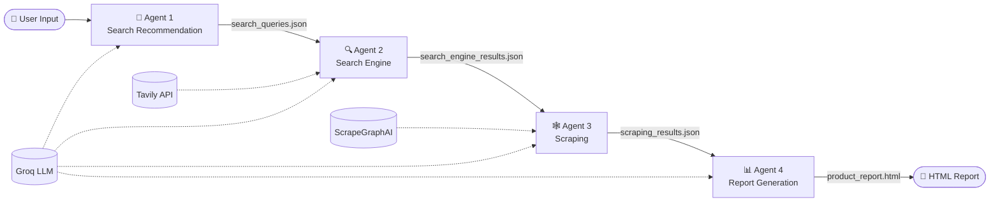
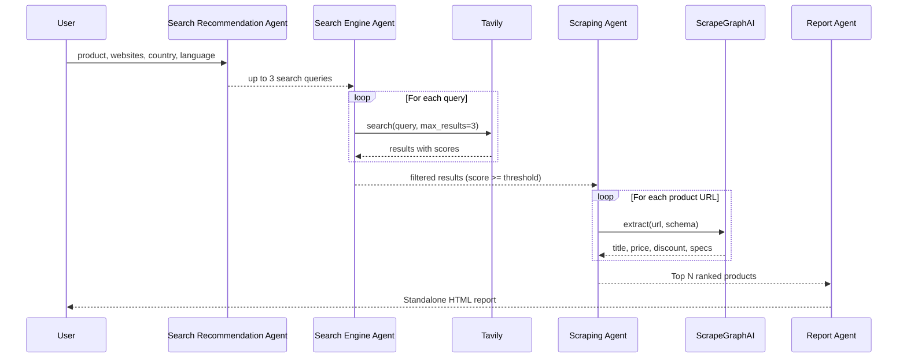

# 🔎 Rankyx — Multi-Agent AI Product Research & Price Comparison

**A multi-agent AI system that finds, scrapes, compares, and reports on products across online stores, so you can buy at the best value-for-money price.**


-green)


---

## 📌 Overview

Rankyx automates product price research. You give it a product name, a list of stores, and a target country. Four specialized AI agents then work in sequence to:

1. Generate smart search queries
2. Search the web for product pages
3. Extract structured product data (price, discount, specs)
4. Produce a professional HTML comparison report

No more opening 20 tabs to compare prices.

---

## ✨ Key Features

- **Multi-agent pipeline** built with [CrewAI](https://docs.crewai.com/) (sequential process)
- **Structured outputs** validated with Pydantic at every stage
- **Country-aware search** (only stores that sell in your target country)
- **Confidence filtering** with a configurable score threshold
- **Smart ranking** of the top N products with recommendation notes
- **Standalone HTML report** styled with Bootstrap, ready to open or share
- **Observability** with [AgentOps](https://www.agentops.ai/) for tracing agent runs
- **Intermediate outputs saved** to `agent-output/` for easy debugging

---

## 🧭 Workflow

### High-level pipeline



### Detailed data flow



### Agent responsibilities

| # | Agent | Input | Output | Tool |
|---|-------|-------|--------|------|
| 1 | **Search Recommendation Agent** | Product, stores, country, language | Up to 3 search queries | None (LLM only) |
| 2 | **Search Engine Agent** | Search queries | Ranked search results | Tavily Search |
| 3 | **Scraping Agent** | Product page URLs | Structured product data | ScrapeGraphAI |
| 4 | **Report Generation Agent** | Extracted products | Full HTML report | None (LLM only) |

---

## 🛠️ Tech Stack

| Layer | Technology |
|-------|-----------|
| Agent framework | CrewAI |
| LLM | `gpt-oss-120b` via Groq (OpenAI-compatible API) |
| Web search | Tavily |
| Web scraping | ScrapeGraphAI |
| Data validation | Pydantic |
| Monitoring | AgentOps |
| Report styling | HTML, CSS, Bootstrap |

---

## 📁 Project Structure

```text
rankyx/
├── main.py                  # Agents, tasks, and crew definition
├── .env                     # API keys (never commit this)
├── requirements.txt
├── README.md
└── agent-output/            # Auto-generated outputs
    ├── search_queries.json
    ├── search_engine_results.json
    ├── scraping_results.json
    └── product_report.html
```

---

## 🚀 Getting Started

### 1. Clone the repository

```bash
git clone https://github.com/<your-username>/rankyx.git
cd rankyx
```

### 2. Create a virtual environment

```bash
python -m venv venv
source venv/bin/activate      # Windows: venv\Scripts\activate
```

### 3. Install dependencies

```bash
pip install crewai agentops tavily-python scrapegraph-py python-dotenv pydantic
```

### 4. Set up environment variables

Create a `.env` file in the project root:

```env
GROQ_API_KEY=your_groq_key
TAVILY_API_KEY=your_tavily_key
SCRAPGRAPH_API_KEY=your_scrapegraph_key
AGENTOPS_API_KEY=your_agentops_key
```

Get your keys here:
- [Groq Console](https://console.groq.com/)
- [Tavily](https://tavily.com/)
- [ScrapeGraphAI](https://scrapegraphai.com/)
- [AgentOps](https://www.agentops.ai/)

### 5. Run the project

```bash
python main.py
```

Open `agent-output/product_report.html` in your browser to see the report.

---

## ⚙️ Configuration

Edit the inputs at the bottom of `main.py`:

```python
crew.kickoff(
    inputs={
        "product_name": "iPhone 14",
        "websites_list": "Amazon, eBay, Walmart",
        "country_name": "Egypt",
        "no_keywords": 3,
        "language": "English",
        "score_threshold": 0.5,
        "top_recommendations_no": 5,
    }
)
```

| Parameter | Description |
|-----------|-------------|
| `product_name` | Product to research |
| `websites_list` | Target stores, comma-separated |
| `country_name` | Country where the product must be sold |
| `no_keywords` | Max number of search queries |
| `language` | Language of the search queries |
| `score_threshold` | Minimum Tavily relevance score (0 to 1) |
| `top_recommendations_no` | Number of top products in the final report |

---

## 📄 Example Output

The final report includes:

- Executive summary
- Product comparison table
- Key specifications
- Price analysis
- Advantages and disadvantages
- Evidence-based recommendations
- Data limitations and source links

---

## 🗺️ Roadmap (Production Plan)

- [ ] REST API with FastAPI
- [ ] Web frontend (Streamlit or Next.js)
- [ ] PostgreSQL storage for results and price history
- [ ] Redis caching and background job queue
- [ ] Scheduled price tracking with alerts
- [ ] Retry logic and robust scraping error handling
- [ ] Dockerize and add CI/CD
- [ ] Cost and token usage tracking
- [ ] User authentication
- [ ] Telegram / WhatsApp bot interface

---

## ⚠️ Limitations

- Results depend on search quality and on how scrapable each store is.
- Some sites block scrapers or load prices dynamically.
- Prices change fast, so reports are a snapshot in time.
- The agents are instructed never to invent missing data, and missing fields are flagged in the report.

---

## 🤝 Contributing

Contributions are welcome:

1. Fork the repo
2. Create a feature branch (`git checkout -b feature/my-feature`)
3. Commit your changes
4. Open a Pull Request

---

## 📜 License

This project is licensed under the MIT License. See `LICENSE` for details.

---

## 👤 Author

**Sama Hassan**
AI Engineer | Cairo, Egypt
[GitHub](https://github.com/) · [LinkedIn](https://linkedin.com/)
