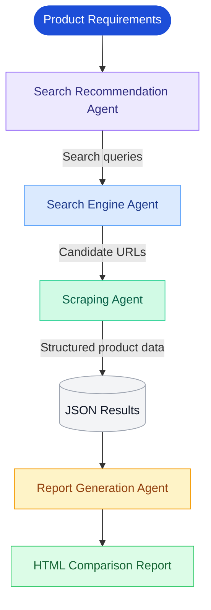
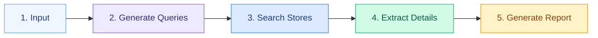

# Rankyx — Multi-Agent AI Product Research & Price Comparison

\<p align="center">
&#x20; \<strong>Automating product discovery, data extraction, and price comparison with AI agents.\</strong>
\</p>

\<p align="center">
&#x20; \
&#x20; \
&#x20; \
&#x20; \
&#x20; \
\</p>

---

## Overview

Rankyx is a multi-agent AI system designed to automate e-commerce product research. It searches for products across online stores, extracts available product information, and generates an HTML report to support value-for-money purchasing decisions.

Instead of manually searching websites and comparing listings, users provide product requirements and let specialized AI agents handle the research workflow.

### Key Features

- **Intelligent query generation:** Creates diverse, targeted search queries.
- **Automated web search:** Discovers potentially relevant product listings using Tavily.
- **AI-powered data extraction:** Extracts product details from e-commerce pages using ScrapeGraphAI.
- **Structured output validation:** Uses Pydantic models to define expected data structures.
- **Product price comparison:** Collects prices, discounts, and specifications when available.
- **Automated reporting:** Generates a standalone HTML comparison report.
- **Agent observability:** Integrates AgentOps to monitor agent executions.

## System Architecture

Rankyx uses CrewAI to orchestrate four specialized agents in a sequential workflow.



### Agent Responsibilities

| Agent                 | Responsibility                       | Main Tools              |
| --------------------- | ------------------------------------ | ----------------------- |
| Search Recommendation | Generates relevant search queries    | CrewAI, Groq, Pydantic  |
| Search Engine         | Retrieves candidate product listings | Tavily API              |
| Scraping              | Extracts product details from pages  | ScrapeGraphAI, Pydantic |
| Report Generation     | Produces the final HTML report       | CrewAI, Groq, HTML, CSS |

## Workflow



1. **Input:** Specify the product, target country, preferred websites, and recommendation limit.
2. **Query generation:** Generate targeted search queries for e-commerce listings.
3. **Search:** Retrieve potentially relevant product pages.
4. **Extraction:** Collect available product titles, prices, URLs, images, and specifications.
5. **Reporting:** Generate an HTML report containing product comparisons and recommendations.

## Technology Stack

\<p align="center">
&#x20; \
\</p>

| Category                  | Technologies         |
| ------------------------- | -------------------- |
| Language                  | Python               |
| Multi-agent orchestration | CrewAI               |
| LLM inference             | Groq                 |
| Web search                | Tavily               |
| Web data extraction       | ScrapeGraphAI        |
| Data validation           | Pydantic             |
| Configuration             | python-dotenv        |
| Observability             | AgentOps             |
| Report presentation       | HTML, CSS, Bootstrap |
| Output formats            | JSON, HTML           |

## Example

The current workflow can be configured to research a product in a specific market.

```python
crew_results = crew.kickoff(
    inputs={
        "product_name": "iPhone 14",
        "websites_list": "Amazon, eBay, Walmart",
        "country_name": "Egypt",
        "no_keywords": 3,
        "language": "English",
        "score_threshold": 0.5,
        "top_recommendations_no": 5
    }
)
```

### Generated Artifacts

| File                         | Purpose                  |
| ---------------------------- | ------------------------ |
| `search_queries.json`        | Generated search queries |
| `search_engine_results.json` | Candidate search results |
| `scraping_results.json`      | Extracted product data   |
| `product_report.html`        | Final comparison report  |

The results depend on search coverage, page accessibility, and the availability of product information. Product prices and availability should be verified against their source pages.

## Project Structure

```text
Rankyx/
├── app.py
├── agent-output/
│   ├── search_queries.json
│   ├── search_engine_results.json
│   ├── scraping_results.json
│   └── product_report.html
├── .env
├── .gitignore
├── requirements.txt
└── README.md
```

This structure reflects the current script-based implementation.

## Getting Started

### Prerequisites

- Python compatible with your installed dependencies
- Groq API key
- Tavily API key
- ScrapeGraphAI API key
- AgentOps API key

### 1. Clone the repository

```bash
git clone https://github.com/YOUR_USERNAME/Rankyx.git
cd Rankyx
```

Replace `YOUR_USERNAME` with your GitHub username.

### 2. Create and activate a virtual environment

**Windows**

```bash
python -m venv .venv
.venv\Scripts\activate
```

**Linux/macOS**

```bash
python3 -m venv .venv
source .venv/bin/activate
```

### 3. Install dependencies

```bash
pip install -r requirements.txt
```

If `requirements.txt` does not exist, create and review one from your tested environment:

```bash
pip freeze > requirements.txt
```

### 4. Configure environment variables

Create a `.env` file in the project root:

```dotenv
GROQ_API_KEY=your_groq_api_key
TAVILY_API_KEY=your_tavily_api_key
SCRAPGRAPH_API_KEY=your_scrapegraph_api_key
AGENTOPS_API_KEY=your_agentops_api_key
```

**Security:** Never commit `.env` or expose API keys in logs or screenshots. Add `.env` to `.gitignore` and commit an `.env.example` with placeholders instead.

### 5. Run the application

```bash
python app.py
```

The agents execute sequentially, and the generated artifacts are saved in `agent-output/`.

## Current Limitations

- Search results may include irrelevant or duplicate listings.
- Some websites may block automated access or expose incomplete data.
- Prices and discounts may be missing or use different currencies.
- Search-score filtering and final recommendation ranking need deterministic enforcement in application code.
- Results are stored locally rather than in a persistent database.
- The workflow currently runs as a Python script rather than a deployed API.
- Automated testing, background jobs, and CI/CD are not yet implemented.

## Production Roadmap

The next stage is to evolve Rankyx into a production-ready application.

- [ ] Refactor the script into modular Python packages.
- [ ] Add structured logging, configuration validation, and robust error handling.
- [ ] Implement unit and integration tests using Pytest.
- [ ] Build a FastAPI backend for comparison requests and report retrieval.
- [ ] Add PostgreSQL and SQLAlchemy for persistent storage.
- [ ] Containerize the application using Docker and Docker Compose.
- [ ] Introduce Redis and Celery for long-running background jobs when needed.
- [ ] Configure GitHub Actions for automated testing and code quality checks.
- [ ] Improve tracing, monitoring, and error reporting.
- [ ] Deploy to a cloud platform with durable report storage.

These are planned enhancements, not features of the current implementation.

## Future Vision

Rankyx aims to become an e-commerce intelligence platform that combines multi-agent AI, automated research, structured product analysis, and production-grade backend engineering to help users make informed purchasing decisions.

## Author

**Sama Hassan**

Computer Science Graduate | AI Engineering | Multi-Agent Systems | LLM Applications

[LinkedIn](https://www.linkedin.com/in/sama-hassans/) · [GitHub](https://github.com/SamaHassa/Rankyx)

---

\<p align="center">
&#x20; \<sub>Built with Python, CrewAI, Groq, Tavily, and ScrapeGraphAI.\</sub>
\</p>
